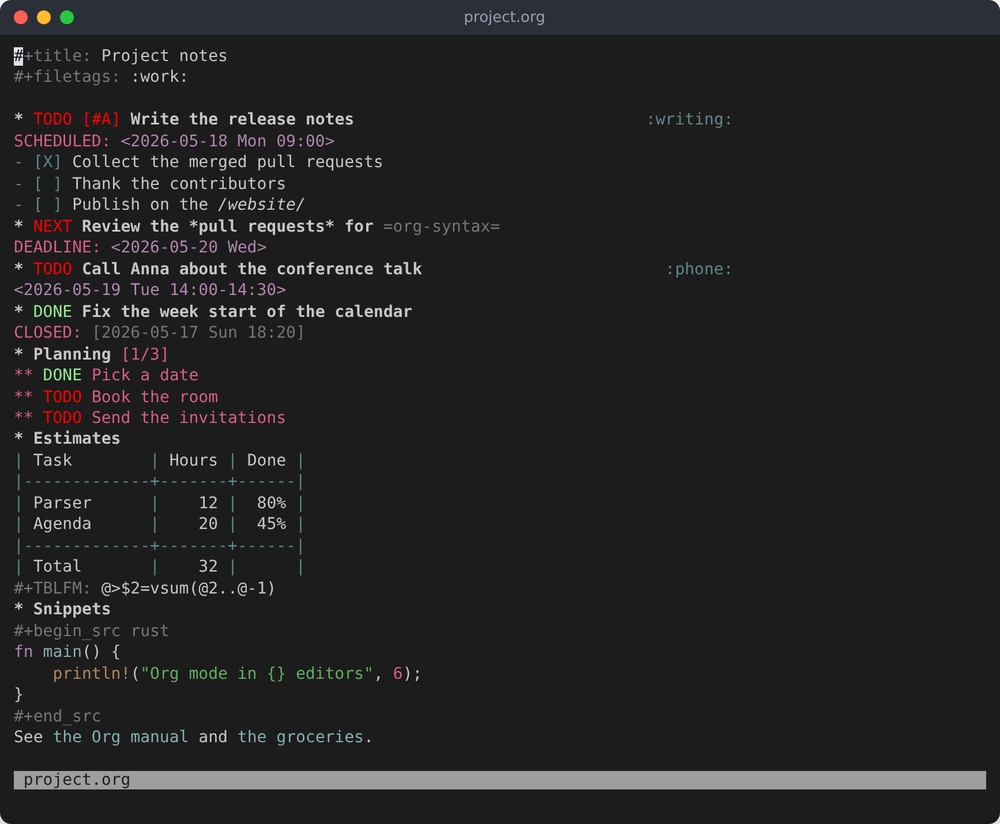
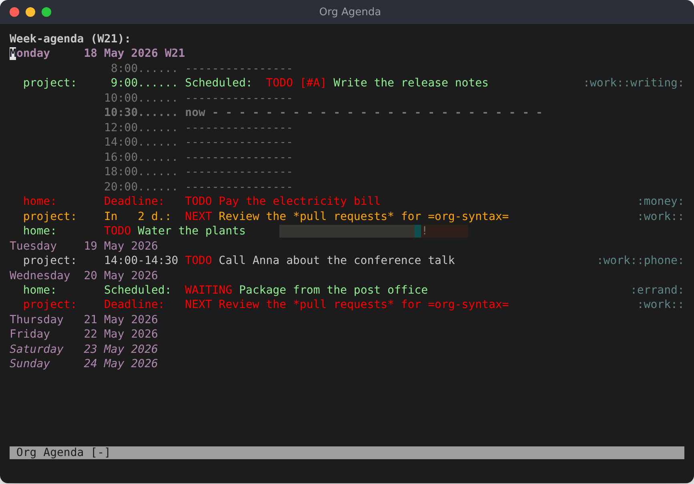
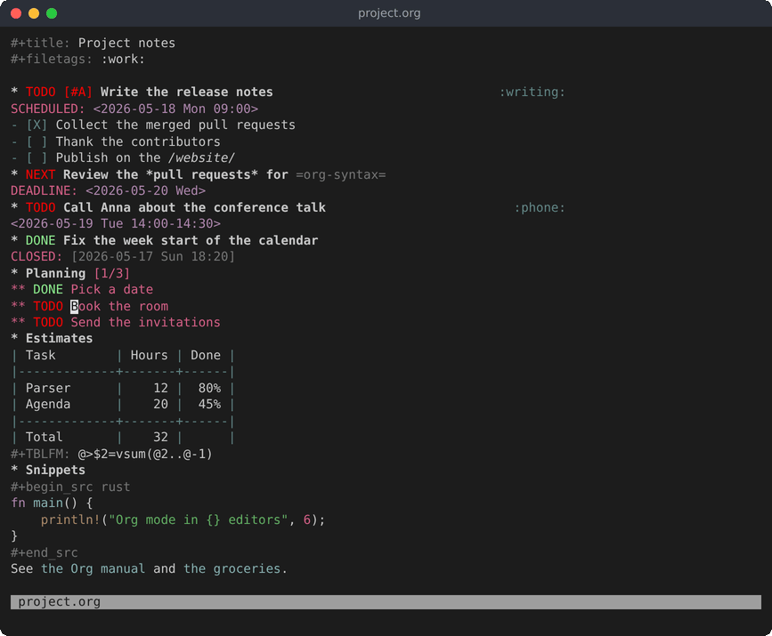

#+title: org-lsp
#+options: ^:{} toc:nil

#+html: 

#+attr_html: :width 128 :alt org-lsp

#+html: 

A language server for [[https://orgmode.org][Org mode]] documents, so that Org works in any editor
with an LSP client instead of in one editor at a time.

The server owns everything about Org: parsing, highlighting, structure and
edits. An editor needs only a thin shim (start the server, map highlight
groups, bind keys), and editors without a plugin system still get whatever
standard LSP can carry.

What org-lsp does, it does as Emacs does: each command is checked against
Emacs (Org 9.8.10) on a test corpus and on random documents, and matches it
there. Export and Babel's evaluation are Emacs itself, run by the server
when Emacs is installed.

AI assistants (Claude Code, Claude Desktop, Cursor and others) can use your
Org files the same way, through the MCP server ~org-lsp mcp~
([[#ai-assistants-mcp][AI assistants (MCP)]]).

#+attr_html: :alt An Org file in Neovim, highlighted by org-lsp

The agenda, built from the Org files as Emacs builds it:

#+attr_html: :alt The agenda of the week in Neovim

Editing as in Emacs: a TODO cycled to ~DONE~ (its parent's ~[2/3]~ counts
it), then a date picked in Org's calendar:

#+attr_html: :alt A TODO cycled to DONE, then a date picked in the calendar

These are Neovim; [[file:scripts/screenshots.py][scripts/screenshots.py]] makes them from the server of the
checkout. The other editors look as their themes make them.

The documentation is also a website, [[https://kristijanhusak.github.io/org-lsp/][kristijanhusak.github.io/org-lsp]],
written from these Org files by org-lsp's own parser (~site/~).

* Editors

Each editor's page says how to install org-lsp there, how to set it up,
and what works:

- [[file:docs/neovim.org][Neovim]] (0.12 or newer): the repository is the plugin.
- [[file:docs/vim.org][Vim]] (9.0.1485 or newer), on top of yegappan/lsp, coc.nvim, vim-lsp or ALE.
- [[file:docs/vscode.org][VS Code]], and VSCodium, Cursor and the like.
- [[file:docs/sublime.org][Sublime Text]], with sublimelsp/LSP.
- [[file:docs/zed.org][Zed]].
- [[file:docs/helix.org][Helix]].

Any other editor: point its LSP client at ~org-lsp~ for the ~org~ file type;
[[file:docs/any-editor.org][docs/any-editor.org]] says what works with no plugin. The server talks over
standard input and output; [[file:docs/protocol.org][docs/protocol.org]] describes the options, the
commands and what an integration has to do.

The server is a single binary, ~org-lsp~. CI builds it for Linux (x86_64,
arm64), macOS (arm64, x86_64) and Windows (x86_64): the [[https://github.com/kristijanhusak/org-lsp/releases/tag/nightly][nightly release]] has
the binaries (~org-lsp-<platform>.tar.gz~), a VS Code package for each
platform with the server inside, the Sublime Text package and the Zed
extension. Version tags make releases of their own. A server says the
commit it was built from with its version: ~org-lsp --version~ prints
~org-lsp 0.1.0-f7e7b68~ (~0.1.0-f7e7b68-dev~ for a build of your own), and in an editor the command /Show the version of
the server/ (~org.version~, ~:Org version~ in Neovim and Vim, a code action
in Zed and Helix) asks the one that runs. Nobody has to fetch
these by hand: the Neovim and Vim plugins download the server the first
time an Org file opens, and for the other editors one script,
~install.sh~, installs the server and the editor's part with it (its
tasks and keys too, in Zed):

#+begin_src sh
curl -fsSL https://github.com/kristijanhusak/org-lsp/releases/download/nightly/install.sh | bash -s -- vscode   # or sublime, zed, helix, server
#+end_src

VS Code also has it on the [[https://marketplace.visualstudio.com/items?itemName=kristijanhusak.org-lsp][Visual Studio Marketplace]] (~code --install-extension kristijanhusak.org-lsp~).

Each editor's page also says how to build it with [[https://rustup.rs][cargo]].

* Configuration

The server's options (TODO keywords, agenda files, capture templates …) are
Org's variables, the same in every editor. The server also reads them from
=~/.config/org-lsp/config.toml= (or ~config.json~) itself, so they can be set
once for every editor; an editor's own settings go on top, and
~org-lsp config~ shows what the server makes of them. [[file:docs/configuration.org][docs/configuration.org]]
has everything that can be set, in every editor.

org-super-agenda, org-roam and org-journal are there too, each off until
turned on: [[file:docs/plugins.org][docs/plugins.org]] has them.

* What works

How much of what Emacs Org does org-lsp does, area by area, and how far
each editor goes with it. Each editor's page has the same table, with what
does not work there and why.

# BEGIN generated: features

| Feature | Parity | Neovim / Vim / VS Code / Sublime Text / Zed / Helix |
|---+---+---|
| [[file:docs/parity.org::#highlighting][Highlighting]] | 100% | ✅ / ❓ / ✅ / ❓ / ❓ / ❓ |
| [[file:docs/parity.org::#folding-and-visibility][Folding and visibility]] | 91% | ❓ / ❓ / ❓ / ❓ / ❓ / ❌ |
| [[file:docs/parity.org::#headings-and-structure][Headings and structure]] | 96% | ✅ / ✅ / ❓ / ✅ / ❓ / ❓ |
| [[file:docs/parity.org::#lists-and-checkboxes][Lists and checkboxes]] | 93% | ✅ / ✅ / ✅ / ✅ / ❓ / ❓ |
| [[file:docs/parity.org::#todo-keywords][TODO keywords]] | 100% | ✅ / ✅ / ✅ / ❓ / ❓ / ❓ |
| [[file:docs/parity.org::#priorities][Priorities]] | 100% | ✅ / ✅ / ✅ / ✅ / ✅ / ✅ |
| [[file:docs/parity.org::#tags][Tags]] | 88% | ✅ / ✅ / ✅ / ❓ / ❓ / ❓ |
| [[file:docs/parity.org::#properties-and-column-view][Properties and column view]] | 100% | ✅ / ❓ / ❓ / ❓ / ❓ / ❓ |
| [[file:docs/parity.org::#dates-and-times][Dates and times]] | 100% | ✅ / ✅ / ✅ / ❓ / ❓ / ❓ |
| [[file:docs/parity.org::#agenda][Agenda]] | 97% | ✅ / ✅ / ❓ / ❓ / ❓ / ❓ |
| [[file:docs/parity.org::#clocking][Clocking]] | 100% | ✅ / ✅ / ✅ / ✅ / ❓ / ❓ |
| [[file:docs/parity.org::#capture][Capture]] | 100% | ✅ / ✅ / ✅ / ✅ / ❓ / ❓ |
| [[file:docs/parity.org::#org-protocol][org-protocol]] | 86% | ✅ / ✅ / ✅ / ✅ / ❓ / ❓ |
| [[file:docs/parity.org::#notes-org-roam][Notes (org-roam)]] | 94% | ✅ / ✅ / ✅ / ✅ / ❓ / ❌ |
| [[file:docs/parity.org::#a-journal-org-journal][A journal (org-journal)]] | 93% | ✅ / ✅ / ✅ / ❓ / ❓ / ❌ |
| [[file:docs/parity.org::#refile-and-archive][Refile and archive]] | 100% | ✅ / ✅ / ✅ / ✅ / ❓ / ❓ |
| [[file:docs/parity.org::#links][Links]] | 96% | ✅ / ✅ / ✅ / ✅ / ❓ / ❓ |
| [[file:docs/parity.org::#footnotes][Footnotes]] | 100% | ✅ / ✅ / ✅ / ✅ / ✅ / ❓ |
| [[file:docs/parity.org::#tables][Tables]] | 100% | ✅ / ✅ / ✅ / ❓ / ❓ / ❓ |
| [[file:docs/parity.org::#table-formulas][Table formulas]] | 100% | ✅ / ✅ / ✅ / ✅ / ❓ / ❓ |
| [[file:docs/parity.org::#code-blocks-babel][Code blocks (Babel)]] | 100% | ✅ / ✅ / ✅ / ✅ / ❓ / ❓ |
| [[file:docs/parity.org::#export-and-publishing][Export and publishing]] | 100% | ✅ / ✅ / ❓ / ✅ / ✅ / ❌ |
| [[file:docs/parity.org::#citations][Citations]] | 82% | ✅ / ✅ / ✅ / ✅ / ❓ / ❓ |
| [[file:docs/parity.org::#diagnostics-org-lint][Diagnostics (org-lint)]] | 100% | ✅ / ✅ / ✅ / ✅ / ✅ / ✅ |
| [[file:docs/parity.org::#indentation-and-formatting][Indentation and formatting]] | 100% | ❓ / ❓ / ❓ / ❓ / ❓ / ❓ |
| [[file:docs/parity.org::#notes-and-logging][Notes and logging]] | 100% | ✅ / ✅ / ✅ / ✅ / ❓ / ❓ |
| [[file:docs/parity.org::#completion-and-editing-helpers][Completion and editing helpers]] | 100% | ✅ / ✅ / ✅ / ✅ / ✅ / ❓ |
| [[file:docs/parity.org::#timers][Timers]] | 100% | ✅ / ✅ / ✅ / ✅ / ❓ / ❌ |
| [[file:docs/parity.org::#attachments][Attachments]] | 100% | ✅ / ✅ / ✅ / ✅ / ❓ / ❓ |
| [[file:docs/parity.org::#encryption][Encryption]] | 100% | ✅ / ✅ / ✅ / ✅ / ❓ / ❓ |
| [[file:docs/parity.org::#inline-images-and-latex-previews][Inline images and LaTeX previews]] | 100% | ❓ / ❌ / ❓ / ❓ / ❌ / ❌ |
| *All of Org* | *97%* |  |

✅ all that org-lsp does works there, ❓ some does not (the editor's page says what and why),
❌ none does, — nothing to support yet. Parity is the share of what
Emacs Org does in that area that org-lsp does; [[file:docs/parity.org][parity.org]] lists both.

# END generated

Tested with Neovim 0.12.0 and 0.12.5, VSCodium 1.135, Vim 9.1 (with
yegappan/lsp, coc.nvim, vim-lsp and ALE) and Helix 25.07.1.

* AI assistants (MCP)
:PROPERTIES:
:CUSTOM_ID: ai-assistants-mcp
:END:

~org-lsp mcp~ is a [[https://modelcontextprotocol.io][Model Context Protocol]] server: an AI assistant reads
your agenda files as Org reads them, from the shared configuration file.

#+begin_src sh
claude mcp add org-lsp -- org-lsp mcp    # Claude Code
#+end_src

- Reading :: the agenda, the TODO list, tags and text searches, custom
  agenda commands, an entry whole, the clock report, capture templates and
  refile targets, org-roam's nodes and backlinks, org-journal's entries.
  Each entry comes with its ~[file:line]~.
- Changing, with ~mcp_edits = true~ :: TODO states, capture, refile,
  scheduling and deadlines, tags, properties, priority, effort, notes,
  archiving and deleting an entry with its subtree, through the same code
  as the editor's commands, each with a ~dry_run~ that shows the change
  first.
- Prompts :: plan the day, review the week, process the inbox, a daily
  standup and stale tasks, each with its data; in Claude Code,
  ~/mcp__org-lsp__plan_my_day~ and the like.

See [[file:docs/mcp.org][docs/mcp.org]] for the setup in each assistant and every tool.

* Without an editor

#+begin_src sh
org-lsp agenda                          # this week, from org_agenda_files
org-lsp agenda --span day --view todo
org-lsp agenda ~/org/work.org           # these files only
org-lsp agenda --help
#+end_src

It reads the shared configuration file (~org-lsp config~ shows it) as the
server does, with ~--options~ on top; ~--no-config~ leaves it out.

~org-lsp notify~, run each minute by cron or a timer
(~scripts/install.sh notifications~ sets it up), reminds of the day's
appointments with desktop notifications, as Emacs's ~appt.el~ does, and
can list the day's deadlines: see [[file:docs/notifications.org][docs/notifications.org]].

Bookmarklets that store a link to a web page or capture it, as Emacs's
org-protocol does, reach the editor with org-lsp through
~org-lsp protocol URL~: see [[file:docs/org-protocol.org][docs/org-protocol.org]].

* Layout

#+begin_example
plugin/, lua/        Neovim plugin (at the root so plugin managers find it)
server/org-syntax/   the Org parser, a library with no LSP in it
server/org-core/     Org's logic: dates, the outline, the agenda, editing
server/org-lsp/      the language server and command line
editors/vscode/      VS Code extension
editors/vim/         Vim plugin, with adapters for four LSP clients
editors/sublime/     Sublime Text package (for sublimelsp/LSP)
editors/zed/         Zed extension
editors/helix/       Helix configuration
docs/                each editor's page, configuration, keys, protocol, parity
site/                the documentation website, written from README.org and docs/
tests/               Org files and what Emacs makes of them
scripts/             checks, generators, reference and fuzzing scripts
#+end_example

* Development

#+begin_src sh
scripts/regen.sh      # write every generated file again
scripts/check.sh      # the fast checks: fmt, clippy, tests, generated files, VS Code, Sublime
scripts/test-all.sh   # those, then Neovim, Vim and VS Code end to end
scripts/site.sh       # the website into target/site (--serve: at localhost:8000)
#+end_src

Set ~ORG_LISP_DIR~ to the ~lisp~ directory of an Org 9.8.10 checkout for the
tests that run Emacs. Everything is checked against Emacs: the files under
~tests/~ come with what Emacs makes of them (syntax trees from
~org-element-parse-buffer~, agendas from ~org-batch-agenda~, the result of
each command), and the tests compare against those committed outputs, so
they need no Emacs. The scripts that record them, and the fuzzers that
compare both programs on random documents, are listed in
[[file:docs/development.org::#how-the-work-is-checked][docs/development.org]]; [[file:docs/parser.org][docs/parser.org]] describes the parser.

[[file:docs/parity.org][docs/parity.org]] lists what Emacs Org does that org-lsp does not yet, area by
area.

org-lsp is written with the help of AI (Claude Code), directed and
reviewed by its author: each change is a pull request that comes with its
tests, and what it does is checked against Emacs as above.

* Licence

Copyright (C) 2026 Kristijan Husak

org-lsp is free software: you can redistribute it and/or modify it under
the terms of the GNU General Public License as published by the Free
Software Foundation, either version 3 of the License, or (at your option)
any later version, as Org mode, whose logic it ports, is. See
[[file:LICENSE][LICENSE]].

The logo, , is Org mode's unicorn by
Christophe Bataillon.
