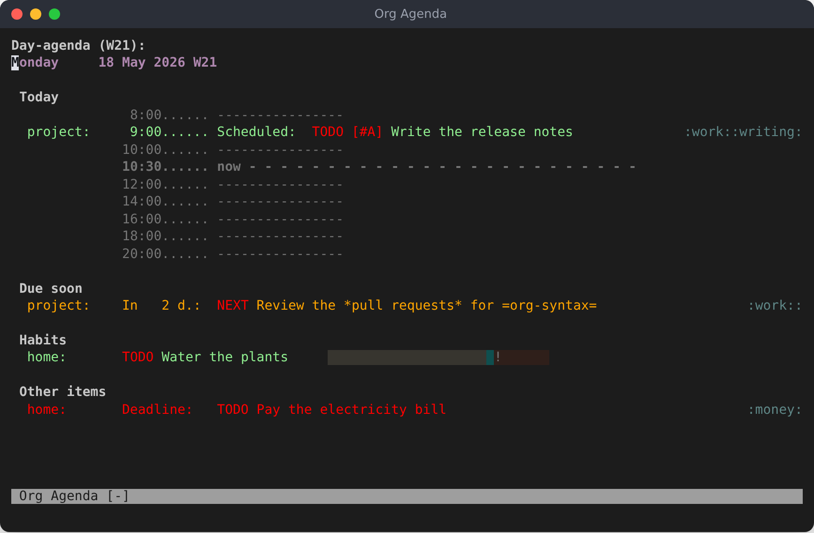
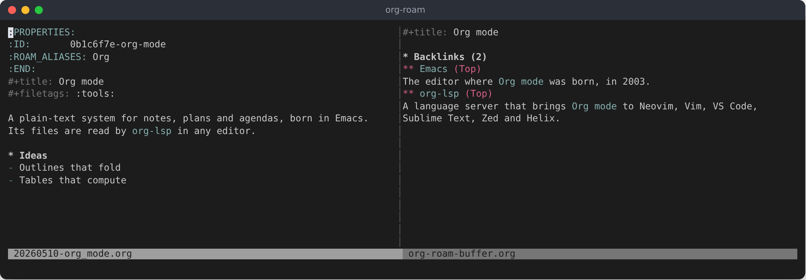
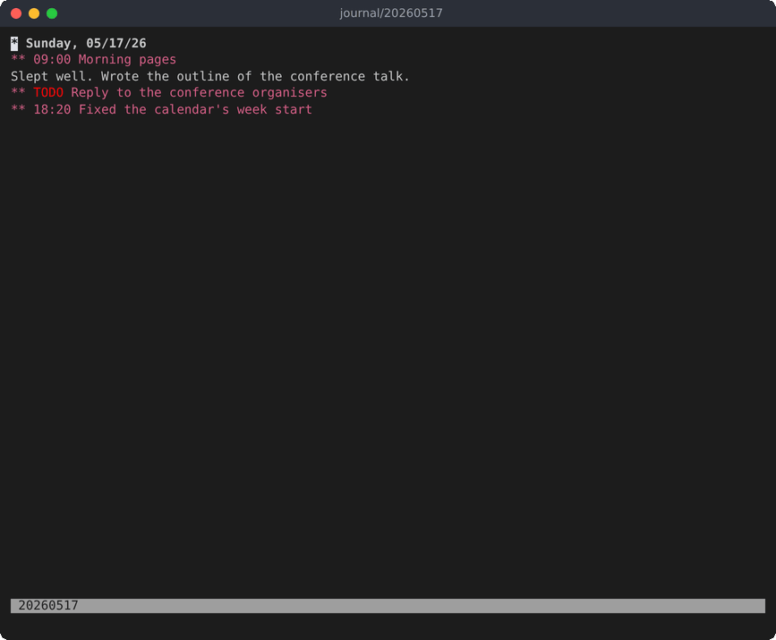

#+title: Plugins
#+options: ^:{} toc:1

Emacs packages built on Org that org-lsp does as well, each as close to
the package as Org itself: their options and commands are the package's,
checked against Emacs with the package loaded, by recorded cases and
differential fuzzing. Each is off until its option turns it on, in the
[[file:configuration.org::#the-shared-configuration-file][shared configuration file]] or in an editor's settings, as the other options
are; [[file:configuration.org::#every-option-at-its-default][configuration.org]] lists their options with the others.

- [[#agenda-groups-org-super-agenda][org-super-agenda]] :: the agenda in groups (~org_super_agenda_mode~).
- [[#notes-org-roam][org-roam]] :: a network of notes (~org_roam_enabled~).
- [[#a-journal-org-journal][org-journal]] :: a journal, a file a day (~org_journal_enabled~).
- [[#bullets-org-bullets][org-bullets]] :: headline stars shown as bullets (~org_bullets_mode~).

* Agenda groups (org-super-agenda)
:PROPERTIES:
:CUSTOM_ID: agenda-groups-org-super-agenda
:END:

The agenda can group its lines as [[https://github.com/alphapapa/org-super-agenda][org-super-agenda]] does: each day of the
agenda, and each other view, is shown in groups, each under a header, in
place of one list. It is off until ~org_super_agenda_mode~ is ~true~; groups
alone do nothing, as in Emacs, where ~org-super-agenda-mode~ turns it on.

~org_super_agenda_groups~ is ~org-super-agenda-groups~: a list of groups,
each a set of selectors with their arguments. Emacs's

#+begin_src emacs-lisp
(setq org-super-agenda-groups
      '((:name "Today" :time-grid t :todo "TODAY")
        (:name "Important" :priority "A")
        (:order-multi (2 (:name "Shopping in town" :and (:tag "shopping" :tag "@town"))
                         (:name "Food-related" :tag ("food" "dinner"))))
        (:name "Waiting" :todo "WAIT" :order 8)
        (:priority<= "B" :order 1)
        (:auto-category t :order 9)))
(org-super-agenda-mode)
#+end_src

is, in the configuration file:

#+begin_src toml
org_super_agenda_mode = true

[[org_super_agenda_groups]]
name = "Today"
time-grid = true
todo = "TODAY"

[[org_super_agenda_groups]]
name = "Important"
priority = "A"

[[org_super_agenda_groups]]
order-multi = [2,
  { name = "Shopping in town", and = ["tag", "shopping", "tag", "@town"] },
  { name = "Food-related", tag = ["food", "dinner"] }]

[[org_super_agenda_groups]]
name = "Waiting"
todo = "WAIT"
order = 8

[[org_super_agenda_groups]]
"priority<=" = "B"
order = 1

[[org_super_agenda_groups]]
auto-category = true
order = 9
#+end_src

A group is an object of selectors, in the order Emacs's plist has them, or
a list of selectors and arguments in turn (~["name", "Today", "time-grid",
true]~), which can name a selector twice, as =(:tag "a" :tag "b")= does.
~true~ is ~t~, ~false~ is ~nil~, and the words a selector takes (~past~,
~today~, ~todo~, ~reverse~ …) are strings. ~"name" = false~ is Emacs's
~:name none~: a group with no header. A separator option of one character
(~org_super_agenda_header_separator = "="~) is Emacs's character (~?=~),
repeated across the window.

The same in an editor's settings, for Neovim:

#+begin_src lua
require('org-lsp').setup({
  settings = {
    org_super_agenda_mode = true,
    org_super_agenda_groups = {
      { name = 'Today', ['time-grid'] = true },
      { 'name', 'Important', 'priority', 'A' },
      { ['auto-category'] = true, order = 9 },
    },
  },
})
#+end_src

A Lua table with keys has no order, so a group with several selectors
whose order matters is better written as a list, as ~Important~ is. In VS
Code's =settings.json= and Sublime Text's settings, a JSON object keeps
its order:

#+begin_src json
{
  "org-lsp.settings": {
    "org_super_agenda_mode": true,
    "org_super_agenda_groups": [
      { "name": "Today", "time-grid": true, "todo": "TODAY" },
      { "auto-category": true, "order": 9 }
    ]
  }
}
#+end_src

A custom command or one of its blocks can have groups of its own, in its
~settings~, as Emacs's =((org-super-agenda-groups '(…)))= does:

#+begin_src toml
[[org_agenda_custom_commands]]
key = "u"
description = "Grouped"
blocks = [
  { type = "agenda", settings = { org_agenda_span = "day", org_super_agenda_groups = [
      { name = "Today", time-grid = true },
    ] } },
  { type = "alltodo", settings = { org_super_agenda_groups = [
      { auto-todo = true },
    ] } },
]
#+end_src

The selectors are those of org-super-agenda 1.4:

- Dates :: ~date~, ~time-grid~, ~deadline~, ~scheduled~, ~effort<~, ~effort>~
- Entries :: ~anything~, ~children~, ~habit~, ~file-path~, ~log~,
  ~heading-regexp~, ~regexp~, ~property~, ~tag~, ~category~, ~todo~,
  ~priority~, ~priority>~, ~priority>=~, ~priority<~, ~priority<=~
- Groups of their own :: ~auto-category~, ~auto-dir-name~, ~auto-group~,
  ~auto-outline-path~, ~auto-parent~, ~auto-planning~, ~auto-priority~,
  ~auto-property~, ~auto-tags~, ~auto-todo~, ~auto-ts~,
  ~ancestor-with-todo~
- Combining :: ~and~, ~not~, ~discard~, ~take~, ~order-multi~, ~order~

The selectors that run Emacs Lisp, ~pred~, ~auto-map~, ~transformer~ and
~property~ with a function, are refused with a message in the view: there
is no Lisp to run. ~face~ is left out: the lines keep their own faces. The
other options are Emacs's: ~org_super_agenda_unmatched_name~,
~org_super_agenda_unmatched_order~, ~org_super_agenda_header_separator~,
~org_super_agenda_header_prefix~, ~org_super_agenda_final_group_separator~,
~org_super_agenda_date_format~, ~org_super_agenda_hide_empty_groups~,
~org_super_agenda_keep_order~, ~org_super_agenda_group_property_name~ and
~org_super_agenda_properties_inherit~.

Emacs loads ~org-habit~ when it loads org-super-agenda, which then draws
habits' consistency graphs; org-lsp draws them only with ~org-habit~ in
~org_modules~. The ~habit~ selector works either way.

* Notes (org-roam)
:PROPERTIES:
:CUSTOM_ID: notes-org-roam
:END:

A directory of notes can be worked on as [[https://www.orgroam.com][org-roam]] does: each file, and
each entry with an ~ID~ property, is a /node/; nodes are found by their
titles and aliases (~ROAM_ALIASES~), linked to with ~id:~ links, and made
with capture templates of their own. It is off until ~org_roam_enabled~ is
~true~, in the configuration file or in an editor's settings, as the other
options are:

#+begin_src toml
org_roam_enabled = true
org_roam_directory = "~/notes"
#+end_src

#+begin_src lua
require('org-lsp').setup({
  settings = { org_roam_enabled = true, org_roam_directory = '~/notes' },
})
#+end_src

The commands are org-roam's:

- ~org.roam.node.find~ :: ~org-roam-node-find~: asks for a node (/Node/,
  completed from the titles and aliases, those of the files changed last
  first, as ~org_roam_node_display_template~ shows them) and visits it; a
  title no node has makes a new node, with a capture.
- ~org.roam.node.insert~ :: ~org-roam-node-insert~: the same question, then
  a link to the node, ~[[id:…][title]]~, at the cursor; with
  ~org_roam_node_formatter~, a template as
  ~org_roam_node_display_template~ is, the description is the node as it
  formats it (~"${title} (${file})"~). On a selection, the selection is
  what is typed first and the link's description, and the link takes its
  place. A new node is linked to once its capture is filed.
- ~org.roam.capture~ :: ~org-roam-capture~: the same question, then a
  capture to the node: to its file for a node that exists.
- ~org.roam.node.random~ :: ~org-roam-node-random~: visits a node picked at
  random.
- ~org.roam.alias.add~, ~org.roam.alias.remove~ :: ~org-roam-alias-add~ and
  ~org-roam-alias-remove~: an alias of the node at the cursor (the entry
  with an ~ID~ that holds it, or the file's) added to its ~ROAM_ALIASES~
  (/Alias/), or one picked among them taken out (/Remove/).
- ~org.roam.ref.add~, ~org.roam.ref.remove~ :: ~org-roam-ref-add~ and
  ~org-roam-ref-remove~: the same for its ~ROAM_REFS~ (/Ref/, /Remove/).
- ~org.roam.ref.find~ :: ~org-roam-ref-find~: visits the node of a reference
  picked among the nodes' references (/Ref/), as org-roam keeps them: a
  URL without its scheme (~//example.com~), a citation key without ~@~.
  When nodes share a reference, the first one's is visited.
- ~org.roam.promote~, ~org.roam.demote~ :: ~org-roam-promote-entire-buffer~
  and ~org-roam-demote-entire-buffer~: a file of one top-level headline made
  the file's node (its title in ~#+title:~, its tags in ~#+filetags:~, the
  other headlines a level up), or back. Without a ~#+title:~, demoting
  fails as in Emacs, but leaves the file as it was.
- ~org.roam.refile~ :: ~org-roam-refile~: the subtree at the cursor moved
  under a node picked (/Node/), a level below it, after its subtree; to a
  file's node, at the end of the file. Before the first headline the whole
  file goes, its node made a headline first, and the file is deleted when
  the editor can delete files (else it is left empty). The selection is not
  refiled instead of the subtree, as it is in Emacs.
- ~org.roam.graph~ :: ~org-roam-graph~: the nodes and the links between
  them drawn by Graphviz (~org_roam_graph_executable~, ~dot~), then shown by
  ~org_roam_graph_viewer~, or opened as the system opens the file. With a
  count, only the nodes connected to the one at the cursor: ~C-u~ (4) any
  number of steps away, another count that many nodes along the way
  (~1~ the node and its own links). Where Emacs says nothing when Graphviz
  fails, org-lsp shows what it wrote; ~org-roam-graph-link-builder~ is
  always org-roam's (an ~org-protocol://roam-node~ link).
- ~org.roam.extract~ :: ~org-roam-extract-subtree~: the subtree at the
  cursor, given an ~ID~ unless it has one, moved to a new file (/Extract
  node to:/, relative to ~org_roam_directory~, offered as
  ~org_roam_extract_new_file_path~ names it) where its headline is the
  file's node. In the name offered, ~${title}~, ~${slug}~ and ~${id}~ are
  the node's, and other ~${…}~ are left for you to replace rather than
  asked for.
- ~org.roam.tag.add~, ~org.roam.tag.remove~ :: ~org-roam-tag-add~ and
  ~org-roam-tag-remove~: tags, separated by colons, added to the node or
  taken out (/Tag/): on its headline, or in ~#+filetags:~ for the file's
  node. They are offered from the tags of the nodes and ~org_tag_alist~,
  or from the node's own.

These commands have no keys, as in Emacs: run them from the editor's
command list, or give them keys of your own.

The org-roam buffer shows what links to a node:

- ~org.roam.buffer.toggle~ :: ~org-roam-buffer-toggle~ (~C-c n l~ in the
  ~emacs~ preset, ~<Leader>nl~ in the ~vim~ one): shows the buffer beside
  the file, for the node at the cursor, or hides it. While it shows, it
  follows the node the cursor is in, in org-roam's files.
- ~org.roam.buffer.dedicated~ :: ~org-roam-buffer-display-dedicated~: a
  buffer of its own for a node asked for (/Node/), which stays on that
  node; with a count (~C-u~), the node at the cursor.
- ~org.roam.buffer.refresh~ :: ~org-roam-buffer-refresh~: the buffer again,
  with what the files say now.

Its sections are those of ~org_roam_mode_sections~: /Backlinks/, the nodes
whose ~id:~ links lead to the node, /Reflinks/, those that link to or cite
one of its ~ROAM_REFS~, and /Unlinked References/, the lines of org-roam's
files that name its title or an alias without a link. Each item is the
node it comes from, its outline path, and the text around the link, as
~org-roam-preview-default-function~ shows it; an unlinked reference is its
file, line, column and the line itself.

A ~roam:~ link names a node by its title or an alias, ~[[roam:A note]]~.
Following it (~org.open~) visits the node, the link first turned into an
~id:~ link to it; a title no node has makes a node, as finding one does.
With ~org_roam_link_auto_replace~ (on by default), saving one of org-roam's
files turns its ~roam:~ links to nodes into ~id:~ links. In those files,
completion in a link, ~[[~, ~[[roam:~ or ~[[id:~, offers the titles and
aliases of the nodes, and the one picked becomes ~[[id:…][title]]~; with
~org_roam_completion_everywhere~, the word at the cursor is completed so
too.

A new node is captured with ~org_roam_capture_templates~, whose default is
org-roam's: a file of its own named after the time and the title's slug,
which starts with the title:

#+begin_src toml
[[org_roam_capture_templates]]
key = "d"
description = "default"
type = "plain"
template = "%?"
target = ["file+head", "%<%Y%m%d%H%M%S>-${slug}.org", "#+title: ${title}\n"]
unnarrowed = true
#+end_src

They are written as ~org_capture_templates~, with org-roam's targets
(~file~, ~file+head~, ~file+olp~, ~file+head+olp~ and ~node~); a path is
relative to ~org_roam_directory~. Besides the escapes of capture templates,
their texts and paths may have ~${title}~, ~${slug}~ and ~${id}~ of the new
node, and ~${name}~ for any other name, which is asked for once (/name/);
~${name=default}~ starts the answer with ~default~. With one template it is
used at once; with more, its key is asked for. The capture buffer shows
what goes into the target: with ~unnarrowed~, the whole file, its ~ID~ and
head too. The node's file is written when the capture is filed
(~org.capture.finish~), and the link of ~org.roam.node.insert~ goes in then.

Daily notes are org-roam-dailies': a file a day in ~org_roam_dailies_directory~
(~daily/~ under ~org_roam_directory~), made with
~org_roam_dailies_capture_templates~, whose default is an entry in a file
named after the day:

#+begin_src toml
[[org_roam_dailies_capture_templates]]
key = "d"
description = "default"
type = "entry"
template = "* %?"
target = ["file+head", "%<%Y-%m-%d>.org", "#+title: %<%Y-%m-%d>\n"]
#+end_src

~%<…>~ and the other escapes of time are the note's day. The commands, under
~C-c n d~ as org-roam's manual binds them:

- ~org.roam.dailies.capture.today~ :: ~org-roam-dailies-capture-today~ (~n~):
  a capture to today's note; with ~C-u~, the note itself.
- ~org.roam.dailies.goto.today~ :: ~org-roam-dailies-goto-today~ (~d~): the
  note of today, made with its ~ID~ and head if it is not there.
- ~org.roam.dailies.goto.tomorrow~, ~org.roam.dailies.goto.yesterday~ ::
  (~t~, ~y~) the note a day on or back, or as many days as the count; their
  ~capture~ relatives capture to it.
- ~org.roam.dailies.capture.date~, ~org.roam.dailies.goto.date~ :: (~v~,
  ~c~) the note of a date picked in the date prompt's calendar, which marks
  the days with a note, or typed as Org's date prompt reads it, a day
  without a year in this year even when it has passed (/Capture to
  daily-note/, /Find daily-note/). With ~C-u~, ~capture.date~ goes to the
  note.
- ~org.roam.dailies.goto.next~, ~org.roam.dailies.goto.previous~ :: (~f~,
  ~b~) from a daily note, the next or previous one there is, or as many on
  as the count: /Already at newest note/ at the last.
- ~org.roam.dailies.find.directory~ :: ~org-roam-dailies-find-directory~
  (~.~): the notes of the directory, those of the directories in it too, in
  the order of their names, to pick one and visit it.

The server keeps no database: it reads the files of the directory when a
command needs them, again when they have changed, in the editor or on
disk, and they are what ~org-roam-db-sync~ would make of them, checked
against Emacs by recorded cases and differential fuzzing. What differs:

- Encrypted files (~.gpg~, ~.age~) are not read.
- The node lines are made for a window 79 columns wide, as Emacs's are in
  a frame of 80; ~${field:*}~ fills the rest of those.
- A ~file+datetree~ target is refused: daily notes are org-journal's (see
  [[#a-journal-org-journal][A journal (org-journal)]]).
- Aborting the capture of a new file (~org.capture.abort~) asks nothing:
  the file was never written.
- A capture whose target file changes in the editor before it is filed is
  refused; abort it and capture again.
- Tags go on the node's headline even when the database does not have the
  node yet (a node not saved, or in a file org-roam cannot read); Emacs
  then puts them on the line of the cursor.
- A link being typed is completed before its closing ~]]~ is typed too,
  and its completions come with the usual ones of a link; Emacs completes
  only between ~[[~ and ~]]~, and only node titles there. After ~[[id:~
  the titles are offered too, which org-roam leaves to Org. A title of
  several nodes is not offered (Emacs fails on it).
- The org-roam buffer is an Org file: its items are headings linking to
  the place they come from, which ~org.open~ visits, and their previews
  are the text, not shown as Emacs shows it in a section of its own.
- The persistent buffer follows the cursor only in editors that report its
  moves (Neovim, Vim, VS Code, Sublime Text); in the others it changes
  with ~org.roam.buffer.toggle~ or ~org.roam.buffer.refresh~.
- Unlinked references are found by the server itself, as ripgrep finds
  them for org-roam (its PCRE pattern, word boundaries, any case), so no
  ~rg~ is needed; encrypted files are not searched.
- ~org-id-locations-file~ is read, never written: an ~id:~ link is
  followed to the files open in the editor, the agenda files, the files
  Emacs listed there and org-roam's files.
- What only Lisp can say is not there: ~org-roam-node-formatter~ as a
  function, and ~org-roam-db-node-include-function~, which decides
  whether each node is one. The links of keyword lines and property
  drawers follow ~org_roam_db_extra_links_elements~ and
  ~org_roam_db_extra_links_exclude_keys~.
- Going to a daily note that is not there writes it, its ~ID~ and head in
  it; Emacs leaves its buffer unsaved. In Sublime Text, Zed and Helix,
  which show no date prompt, its date is typed.
- ~org-roam-dailies-find-directory~ opens the directory in Dired, where
  the editors have no list of a directory's files to show for a server:
  its notes are offered to pick from instead, as the editor offers any
  choice.

* A journal (org-journal)
:PROPERTIES:
:CUSTOM_ID: a-journal-org-journal
:END:

A journal can be kept as [[https://github.com/bastibe/org-journal][org-journal]] keeps it: a file a day in a
directory (or a file a week, month or year, ~org_journal_file_type~), an
entry for each day under a headline with its date, and under it one for
each time something is written. It is off until ~org_journal_enabled~ is
~true~:

#+begin_src toml
org_journal_enabled = true
org_journal_dir = "~/journal"
#+end_src

#+begin_src lua
require('org-lsp').setup({
  settings = { org_journal_enabled = true, org_journal_dir = '~/journal' },
})
#+end_src

The commands are org-journal's:

- ~org.journal.new.entry~ :: ~org-journal-new-entry~ (~C-c j j~ in the
  ~emacs~ preset, ~<Leader>jj~ in the ~vim~ one): today's file, today's
  entry made if it is not there yet, and a new entry in it with the time
  (~org_journal_time_format~). With a count (~C-u~), today's entry only.
  The first entry of a day takes the items of the entry before it that
  ~org_journal_carryover_items~ matches (TODO items unless set), with the
  headlines above them, out of that entry.
- ~org.journal.new.date.entry~ :: ~org-journal-new-date-entry~: the same
  for a date asked for (/Date/, as Org's date prompt reads it).
- ~org.journal.new.scheduled.entry~ :: ~org-journal-new-scheduled-entry~:
  a TODO entry for a day to come (/Date/), with its timestamp after
  ~org_journal_scheduled_string~. With a count, an entry that is not a
  TODO.
- ~org.journal.next.entry~, ~org.journal.previous.entry~ ::
  ~org-journal-next-entry~ (~C-c j f~, ~<Leader>jf~) and
  ~org-journal-previous-entry~ (~C-c j b~, ~<Leader>jb~), in a journal
  file: the entry of the day after the one at the cursor, or before, in
  whatever file it is.
- ~org.journal.open.current~ :: ~org-journal-open-current-journal-file~:
  the file of today.
- ~org.journal.reschedule~ :: ~org-journal-reschedule-scheduled-entry~, on
  an entry to come: it moves to the day asked for (/Date/), its time and
  timestamp changed for that day's.

The journal is searched, as ~search-forward~ searches, without regard to
case:

- ~org.journal.search~ :: ~org-journal-search~ (~C-c j s~, ~<Leader>js~):
  asks for the string (/Enter a string to search for/), then the first and
  the last day (/Enter the search start/, /Enter the search end/); with a
  count, every day.
- ~org.journal.search.forever~, ~org.journal.search.future~ ::
  ~org-journal-search-forever~ and ~org-journal-search-future~: every day,
  or from today on.
- ~org.journal.search.future.scheduled~ ::
  ~org-journal-search-future-scheduled~: the TODO entries from today on.

The results are a file of their own, ~org-journal-search.org~: each line
is the day of an entry, which links to the line it was found on
(~org.open~ follows it), and the line itself, in the order of
~org_journal_search_results_order_by~ and with the dates of
~org_journal_search_result_date_format~. The entries to come with a
timestamp from now on are another one, ~org-journal-schedule.org~:

- ~org.journal.schedule.view~ :: ~org-journal-schedule-view~.

The date prompt's calendar marks the days with an entry, as
~org-journal-mark-entries~ does: before now, and to come.

Each shows the entry it is about, in its file, and with
~org_journal_hide_entries_p~ (on by default) the other entries folded, as
org-journal leaves them. A new entry made from another file, and today's
file, show in another window, as ~org-journal-find-file-fn~
(~find-file-other-window~) shows them; with
~org_journal_find_file_fn = "find-file"~ they show where the command was
run. Zed and Helix show them where they show any file. A journal file that is not open is written to
disk; one that is open is changed in the editor, for it to save.
~org_journal_enable_agenda_integration~ puts the files from yesterday on
in ~org_agenda_files~, as ~org-journal-enable-agenda-integration~ does.

org-journal's files have no extension unless ~org_journal_file_format~
gives them one (~%Y%m%d.org~). Neovim, Vim, VS Code and Sublime Text open
the files of ~org_journal_dir~ without an extension as Org files, as the
server tells them where it is. Zed and Helix are told ahead of time which
files are Org: add the directory there (here ~journal~), or give the
files ~.org~:

#+begin_src json
{ "file_types": { "Org": ["**/journal/*"] } }
#+end_src

#+begin_src toml
# ~/.config/helix/languages.toml, in the [[language]] of org
file-types = ["org", { glob = "journal/*" }]
#+end_src

The commands are what org-journal does, checked against Emacs by recorded
cases and differential fuzzing, its oddities too (an entry for a day
before all the others goes first in its file). What differs:

- The keys are under ~C-c j~, the prefix org-journal's README suggests,
  rather than its default, ~C-c C-~, whose keys are Org's.
- A file that is not open is written to disk; Emacs leaves the buffer it
  changed unsaved.
- Folds close and open by headlines: a headline whose children show but
  whose text does not shows open.
- Folds open and close only in Neovim, Vim, VS Code and Sublime Text; in
  Zed and Helix the file shows as it does.
- ~org-journal-encrypt-journal~ (files encrypted whole, ~.gpg~) is not
  there: Emacs decrypts such a file in memory, where the editors would
  need it decrypted on disk, or a way of their own to read it.
  ~org_journal_enable_encryption~, with ~org-crypt~, is there.
- ~org-journal-follow-mode~ and ~org-journal-enable-cache~ are not there:
  the one shows the entries of the days ~M-x calendar~ moves to, the other
  keeps that calendar's days in a file between sessions, and the date
  prompt's calendar reads the directory each time it opens.
- The search results are an Org file whose dates are links, two blanks
  before the line found where Emacs has a tab, in place of a buffer of
  buttons (~n~, ~p~, ~TAB~ move between them, and the first
  result shows beside them); its matches are not highlighted. An empty
  string finds every entry with a time, which Emacs means to do but hangs
  on.
- The keys org-journal adds to ~M-x calendar~ (~j r~, ~j d~, ~[~, ~]~,
  ~j s~ …) are not there: org-lsp has no calendar of its own, only the
  date prompt's, where Emacs has them neither.
- Dates are written as in the C locale: ~%x~ is ~05/15/26~ and ~%A~
  ~Friday~ whatever the system's locale is. A journal Emacs kept under
  another locale (~en_US.UTF-8~ writes ~05/15/2026~) has headings org-lsp
  does not find; set ~org_journal_date_format~ to a format without ~%x~,
  such as ~"%A, %m/%d/%Y"~, to match them.

* Bullets (org-bullets)
:PROPERTIES:
:CUSTOM_ID: bullets-org-bullets
:END:

Headlines can show as [[https://github.com/sabof/org-bullets][org-bullets]] shows them: the last star of each is
drawn as a bullet, the one of its level in ~org_bullets_bullet_list~ (~◉~,
~○~, ~✸~, ~✿~, then again from the first), and the stars before it are
hidden in their place, as ~org_hide_leading_stars~ hides them. It is off
until ~org_bullets_mode~ is ~true~:

#+begin_src toml
org_bullets_mode = true
org_bullets_bullet_list = ["●", "○", "◆", "◇"]
#+end_src

As [[https://github.com/nvim-orgmode/org-bullets.nvim][org-bullets.nvim]] does, the ~-~, ~+~ and ~*~ of list items show as
~org_bullets_list_bullet~ (~•~), and the mark between the brackets of a
checkbox as the one ~org_bullets_checkboxes~ gives its state: ~[ ]~ and
~[-]~ as they are, ~[✓]~ for ~[X]~ (org-bullets.nvim shows ~[˟]~ for
~[ ]~). ~false~ turns either off:

#+begin_src toml
org_bullets_list_bullet = "–"
org_bullets_checkboxes = { todo = "˟", done = "✔" }
#+end_src

The text does not change: the bullet is drawn in place of the star, as
pretty entities are, by the editor where it can (Neovim), else as an inlay
hint (VS Code, Zed, Helix); the leading stars are hidden where virtual
indentation can hide them (Neovim, VS Code). A bullet takes the colors of
what it stands for, as the composed character keeps the face of the star
in Emacs: the headline's level, the list's bullet, the checkbox's state.
That is in Neovim only: VS Code cannot give a decoration or an inlay hint
the colors of a token. As in Emacs, every line that starts with stars and
a space gets its bullet. What differs: ~org-bullets-face-name~ is not read
(the bullet keeps the headline's colors), clicking a bullet does not cycle
the headline, and inline tasks have no second bullet.
